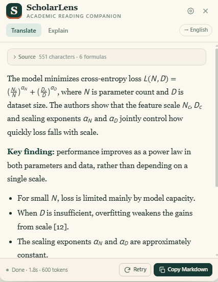
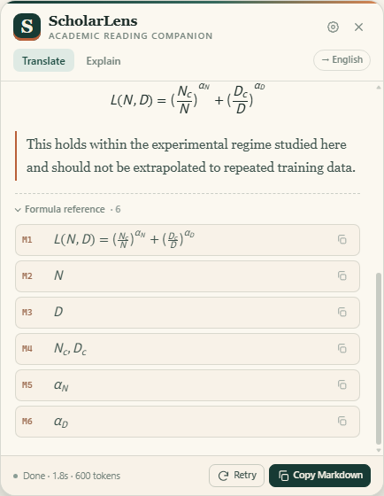
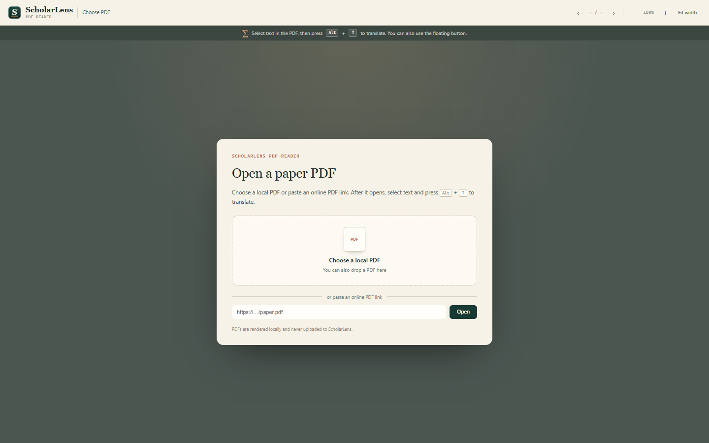
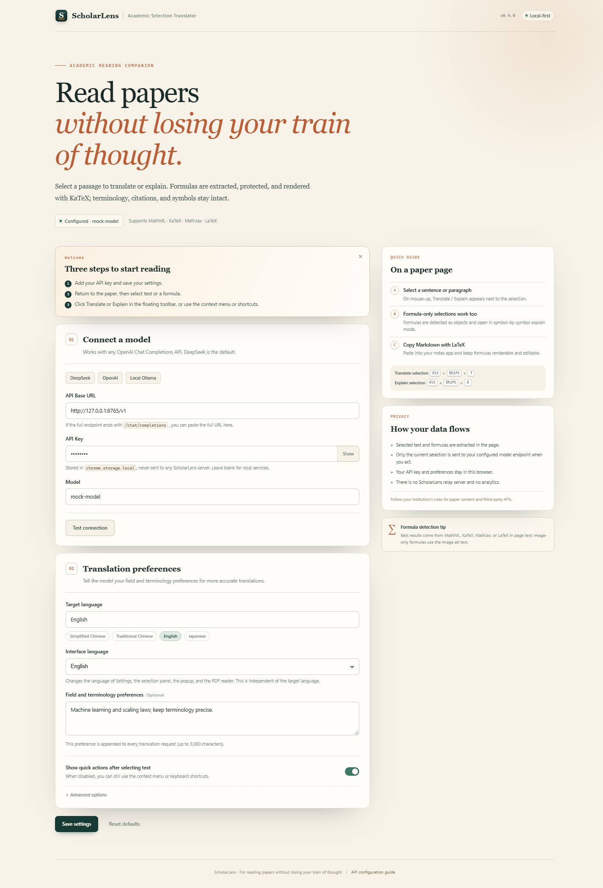

# ScholarLens

**Academic reading, without losing your train of thought.**  
Selection translation with formula preservation for browsers and Zotero.

*学术阅读，不打断思路。为浏览器与 Zotero 提供保留公式的划词翻译。*

ScholarLens is an open-source academic translator that keeps equations, terminology, citations, and notation intact. It extracts formulas before translation, protects them as placeholders, and renders them back with KaTeX.

- Repository: <https://github.com/577glq/scholarlens>
- Downloads: [GitHub Releases](https://github.com/577glq/scholarlens/releases)
- Issues: <https://github.com/577glq/scholarlens/issues>

| Component | Works with | Version |
|---|---|---|
| Browser extension | Chrome / Edge · web pages · online PDFs · local PDFs | 0.4.0 |
| Zotero plugin | Zotero 7+ built-in PDF reader | 0.1.4 |

The browser interface supports **English and Chinese** from Settings → Interface language. Target language and interface language are independent.

## Screenshots









## Features

- Select text to translate or explain. On web pages, press `Alt+T`.
- Academic prompts preserve terminology, numbers, units, citations, and cross-references.
- Formula protection for MathML, KaTeX, MathJax, MediaWiki formulas, image alt text, and inline LaTeX (`$...$`, `\(...\)`, `\[...\]`).
- KaTeX rendering in the result, plus a formula reference list with copyable LaTeX.
- Missing-formula detection: if the model drops a placeholder, ScholarLens warns you and keeps the source formula available.
- Formula-only selections automatically switch to symbol-by-symbol explanation.
- **ScholarLens PDF Reader** for online and local PDFs, with text selection and `Alt+T`.
- Streaming output, stop, retry, and Markdown copy with `$...$` / `$$...$$`.
- OpenAI-compatible Chat Completions API. Defaults to DeepSeek; OpenAI and local Ollama work too.
- No relay server, no analytics. API keys stay in local browser or Zotero storage.

## Install

### Browser extension

1. Download [ScholarLens-v0.4.0.zip](https://github.com/577glq/scholarlens/releases/download/v0.4.0/ScholarLens-v0.4.0.zip).
2. Unzip it anywhere.
3. Open `chrome://extensions` or `edge://extensions`.
4. Enable **Developer mode**, choose **Load unpacked**, and select the folder containing `manifest.json`.
5. The settings page opens on first install. Add an API key and save.

Chrome / Edge 109 or later is required.

> Chrome 137+ no longer supports `--load-extension` from the command line. Loading an unpacked extension from the extensions page still works.

### Zotero plugin

1. Download [scholarlens-zotero-0.1.4.xpi](https://github.com/577glq/scholarlens/releases/download/v0.4.0/scholarlens-zotero-0.1.4.xpi).
2. In Zotero: **Tools → Add-ons → gear → Install Add-on From File**.
3. Select the `.xpi` and restart Zotero.
4. Configure the API in **Zotero Settings → ScholarLens**.

## Configure a model

| Service | API Base | Model example |
|---|---|---|
| DeepSeek | `https://api.deepseek.com/v1` | `deepseek-chat` |
| OpenAI | `https://api.openai.com/v1` | `gpt-4o-mini` |
| Local Ollama | `http://localhost:11434/v1` | a model installed locally |

Keep API keys in the extension or Zotero settings. Never commit them to this repository.

## Usage

### Browser

- **Web pages:** select text, then click **Translate / Explain** or press `Alt+T` / `Alt+Shift+E`.
- **Online PDFs:** open the toolbar popup and choose **Open PDF reader**.
- **Local PDFs:** open **Open PDF reader**, then choose or drop a PDF file.
- In the ScholarLens reader, select text and press `Alt+T`.

### Zotero

1. Select text in Zotero's built-in PDF reader.
2. Choose **ScholarLens translate** or **ScholarLens explain** in the selection popup.
3. Use **Zotero Settings → ScholarLens** for API configuration and connection testing.

## How it works

1. Extract the selection and any formulas.
2. Convert formulas to LaTeX and replace them with placeholders such as `⟦M1⟧`.
3. Ask the model to translate the text while preserving every placeholder.
4. Validate the output and detect missing placeholders.
5. Render formulas with KaTeX; restore `$...$` / `$$...$$` in copied Markdown.

## Privacy

- No ScholarLens relay server and no telemetry.
- Only the current selection is sent to the API endpoint you configure.
- Browser API keys are stored in `chrome.storage.local`; Zotero keys are stored in local Zotero preferences.
- The PDF reader renders PDFs locally. Online PDFs require permission for that domain.
- Do not commit API keys, cookies, browser profiles, Zotero databases, or screenshots containing private material.

## Limitations

- Chrome/Edge's built-in PDF viewer does not expose selections to extensions. Use the ScholarLens reader or paste mode.
- Scanned PDFs without a text layer cannot be selected; OCR is not included.
- PDF formulas are usually plain Unicode text, not structured LaTeX. Formula fidelity is better on HTML pages with MathML or KaTeX.
- Some online PDFs require login, block hotlinking, or forbid extension fetches. Use a local copy instead.
- Iframes are not injected into; only the top-level page is handled.

## Repository layout

```text
.
├── src/                     # Browser extension
│   ├── background.js
│   ├── content.js
│   ├── lib/                 # extraction, formulas, Markdown, prompts, i18n
│   ├── options.*            # settings page
│   ├── popup.*              # PDF / clipboard popup
│   └── pdfviewer.*          # PDF.js reader
├── docs/                    # README screenshots
├── scripts/                 # build and packaging
├── test/                    # mock API, sample page, browser tests
├── scholarlens-zotero/      # Zotero 7+ plugin
├── release/                 # local build output (not committed)
└── dist/                    # extension build output (not committed)
```

## Development

### Browser extension

```bash
npm install
npm run build
npm run package
```

`npm run build` writes `dist/`; `npm run package` writes `release/ScholarLens-v0.4.0.zip`.

### Zotero plugin

```bash
cd scholarlens-zotero
npm install
npm run build
```

See [scholarlens-zotero/README.md](scholarlens-zotero/README.md).

## Release assets

- `ScholarLens-v0.4.0.zip` — browser extension
- `scholarlens-zotero-0.1.4.xpi` — Zotero plugin

Build artifacts are published as GitHub Releases and are not committed to Git history.

## Contributing and security

- [Contributing](CONTRIBUTING.md)
- [Security policy](SECURITY.md)
- [Changelog](CHANGELOG.md)

## License

Original code is released under the [MIT License](LICENSE).

Third-party components:

- KaTeX — MIT
- mathml-to-latex — MIT
- @xmldom/xmldom — MIT
- PDF.js — Apache-2.0
- esbuild / fflate — MIT (build tooling)

See [THIRD_PARTY_NOTICES.md](THIRD_PARTY_NOTICES.md) for details. The Zotero plugin includes its own [LICENSE](scholarlens-zotero/LICENSE).
